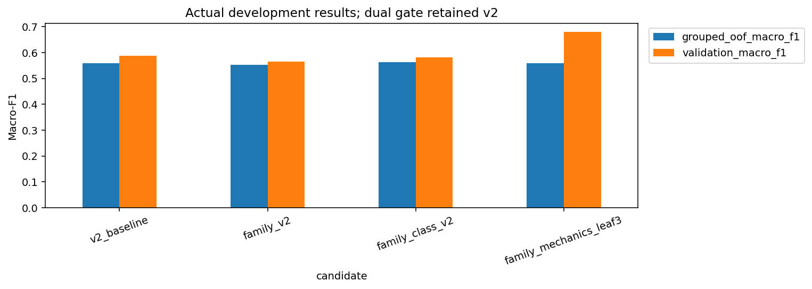

# Code Complexity Predictor

Predict coarse time/space complexity labels from C++ source without compiling it. The project includes lexical classifiers, a token CNN and structural ensembles trained on the real TASTY corpus. Predictions are statistical estimates, not complexity proofs.

## Run

Run these commands from this repository's root.

Use a separate environment for this repository; the generic `src` package conflicts with the other projects if installed together.

```powershell
python -m venv .venv
.\.venv\Scripts\Activate.ps1
python -m pip install -e ".[dev,notebooks]"
python -m src.data.tasty --target time_complexity
python -m pytest -q
python train.py selected --data data/processed/tasty-time_complexity.jsonl --output models/my-ensemble
python -m src.models.predict_model examples/linear.cpp --model models/my-ensemble
```

Install `.[neural]` for token-CNN experiments; the retained ensemble uses scikit-learn. Time-task results are reported below.

Weights are ignored and must be trained or supplied locally. The validation study requires the documented frozen dataset/split paths; it does not silently create a new test split or score the observed test. Use fresh output directories. Training scores validation only, then refits on all 1,107 development rows; explicit observed-test evaluation is available through `evaluation_scripts/evaluate.py selected --output models/my-ensemble --data data/processed/tasty-time_complexity.jsonl --report models/my-observed-report.json --observed-holdout`. For Linux/macOS, activate `.venv/bin/activate`.

## Notebooks and results

Launch `python -m jupyter lab` from the activated environment.

- [Real source, class balance and grouped EDA](notebooks/01_source_and_grouped_eda.ipynb)
- [Main algorithms and experiments](notebooks/02_main_algorithms_and_experiments.ipynb): readable core code, grouped classifiers and executed validation comparisons.
- [Evaluation and minority errors](notebooks/03_evaluation_and_minority_errors.ipynb): executed class metrics, figures and saved-model inference.

The retained ensemble reached validation macro-F1 **0.58825** and previously observed test macro-F1 **0.65150**. See [Report.md](Report.md) for validation selection and [dataset/license notes](docs/datasets.md).

The time task has 1,382 accepted snippets and six classes. Minority support is small, source/problem IDs are incomplete and clone grouping is approximate. Previously observed test scores are retrospective. Scores are uncalibrated; macros, templates, library costs and input-size assumptions need human review. Data, source-row predictions, secrets and weights stay ignored.


